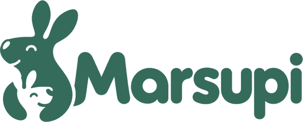
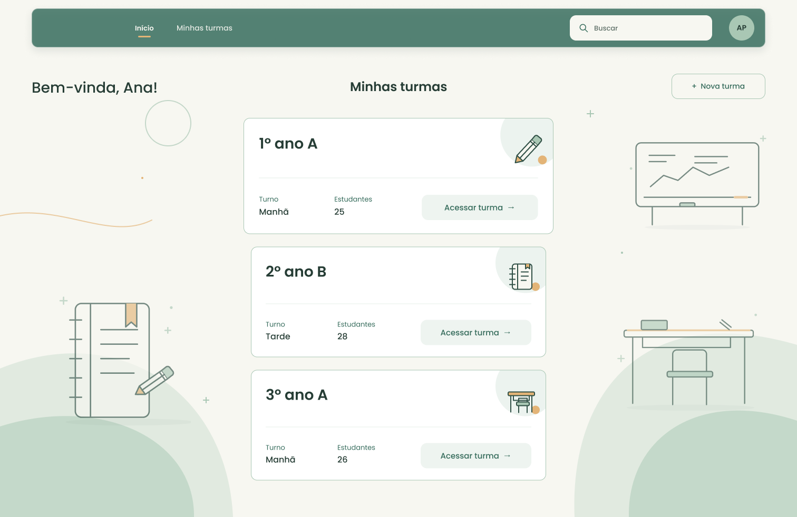
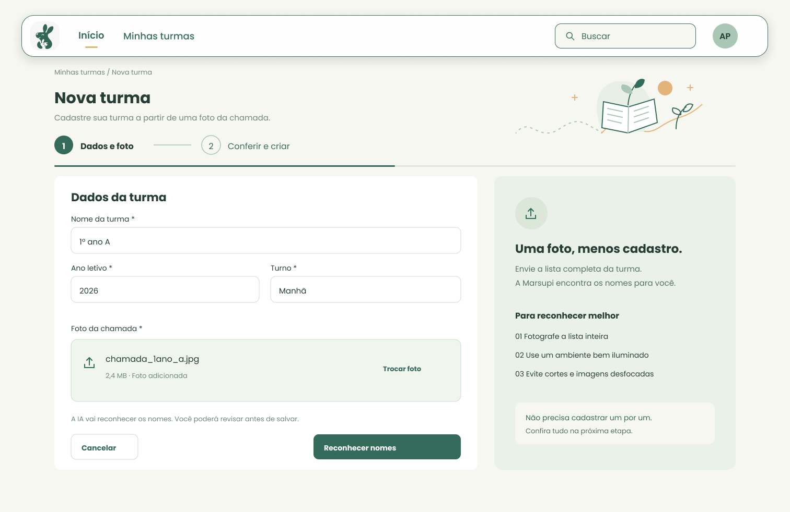
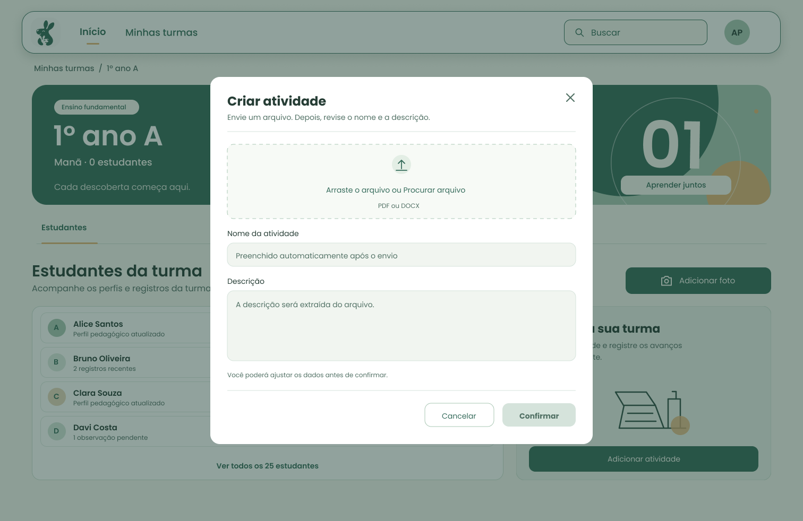
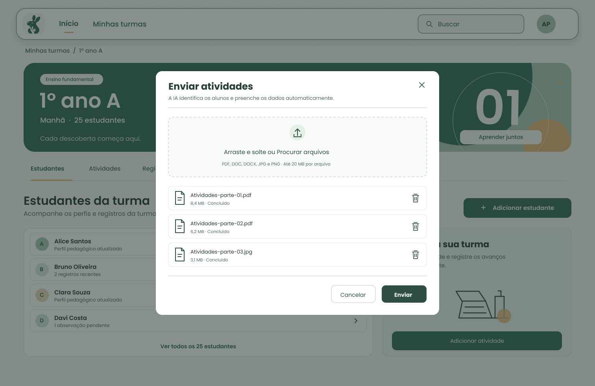
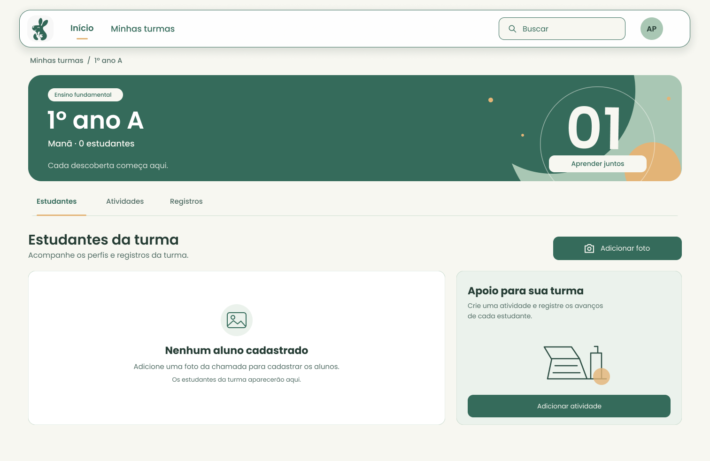
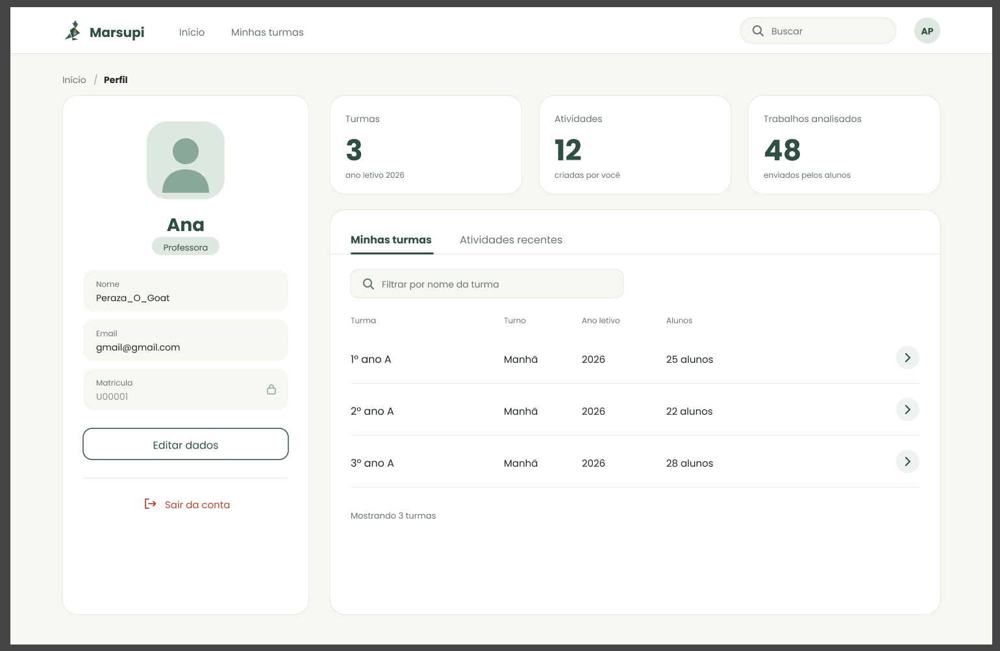

  

<h3 align="center">O copiloto pedagógico da professora do 1º ano</h3>

  Da foto da chamada à atividade certa para cada criança, com IA, sem diagnóstico e com a LGPD em primeiro lugar.

  <a href="https://delta.fabricadesoftware.ifc.edu.br"><b>Acessar o Marsupi</b></a> ·
  <a href="https://github.com/Hackathon-Fabrica-2k26/Backend_template">Backend</a> ·
  <a href="https://github.com/Hackathon-Fabrica-2k26/Frontend_template">Frontend</a> ·
  <a href="https://github.com/Hackathon-Fabrica-2k26/Mobile_template">Mobile</a>

  Hackathon Fábrica de Software 2026 · IFC Campus Araquari · desafio <i>“Do Zero à Autonomia: 24H com IA”</i>

---

## O problema

Uma professora do 1º ano tem de 25 a 35 crianças na sala, cada uma num ritmo. Ela sabe que a IA poderia ajudar, mas:

- pergunta de forma genérica e recebe conselhos genéricos;
- não sabe que contexto dar para a IA, nem o que **não** pode dar (dados de crianças são protegidos pelo Art. 14 da LGPD);
- não tem tempo de adaptar a mesma atividade para cada criança.

## A proposta

O **Marsupi** conduz a professora do primeiro contato ao uso autônomo da IA no dia a dia da sala:

| Passo | O que a professora faz | O que o Marsupi faz |
|---|---|---|
| 1. Turma | Tira uma foto da lista de chamada | Lê os nomes, mostra a confiança de cada um e pede conferência dos duvidosos |
| 2. Atividade | Envia a atividade em PDF, DOCX ou foto | Extrai o texto e sugere título e descrição |
| 3. Versões | Clica em “Gerar versões” | Separa os alunos pela **habilidade a reforçar** (lista fixa do 1º ano, referência BNCC) e gera uma versão para cada grupo, sem mudar as questões |
| 4. Trabalhos | Fotografa os trabalhos entregues | Identifica de quem é cada um, aponta habilidades demonstradas e a reforçar e gera o relatório |
| 5. Acompanhamento | Abre o painel do aluno | Mostra relatórios, pontos de atenção (só com 3 ou mais trabalhos) e exporta tudo em PDF |

**Responsáveis entram sem criar conta:** a professora gera um link com código de uso único; o responsável dá o consentimento e pode enviar o laudo, que vira apenas necessidades e adaptações pedagógicas e é apagado logo depois.

## Telas

Telas do design (Figma). O produto publicado pode ter pequenas diferenças.

<table>
  <tr>
    <td width="50%">
Início: as turmas da professora
</td>
    <td width="50%">
Nova turma pela foto da chamada
</td>
  </tr>
  <tr>
    <td>
Criar atividade (PDF, DOCX ou foto)
</td>
    <td>
Enviar os trabalhos da turma
</td>
  </tr>
  <tr>
    <td>
Página da turma
</td>
    <td>
Perfil da professora
</td>
  </tr>
</table>

## Ética e privacidade

- **Não é ferramenta de diagnóstico.** O Marsupi nunca fala em TDAH, autismo, CID ou transtorno; fala em *habilidade a reforçar* e *necessidade pedagógica*.
- **Nenhum nome de criança vai para a IA.** Os textos são anonimizados antes; os nomes são casados no servidor.
- **Só com consentimento.** Aluno sem consentimento ativo do responsável não passa pela IA.
- **Arquivos não ficam guardados.** Fotos de trabalhos e laudos são lidos em memória e descartados.
- **A professora decide.** Toda versão e todo relatório passam pela revisão dela antes de ir para a sala.

## Tecnologia

| Parte | Stack |
|---|---|
| Backend | Python 3.13 · Django 5 · Django REST Framework · JWT · Google Gemini · ReportLab |
| Frontend | Vue 3 · Vuetify · TypeScript · Vite · Tailwind (utilitários) |
| Mobile | Flutter (APK gerado pelo GitHub Actions) |
| Deploy | GitHub Actions → Dokku (IFC Araquari) |

## Equipe

<table>
  <tr>
    <td align="center" width="16%"><a href="https://github.com/jonatasperaza"> <b>Jonatas Silva Peraza</b></a></td>
    <td align="center" width="16%"><a href="https://github.com/IgorMMichels"> <b>Igor Michels</b></a></td>
    <td align="center" width="16%"><a href="https://github.com/MatheusZenere"> <b>Matheus Vidal Zenere</b></a></td>
    <td align="center" width="16%"><a href="https://github.com/Mateus2411"> <b>Mateus Henrique da Silva</b></a></td>
    <td align="center" width="16%"><a href="https://github.com/mklamaral"> <b>Mikael Amaral</b></a></td>
    <td align="center" width="16%"><a href="https://github.com/Pedrojoseroza"> <b>Pedro José Oliveira da Roza</b></a></td>
  </tr>
  <tr>
    <td align="center" width="16%"><a href="https://github.com/HigorAmaral"> <b>Higor do Amaral Fritz</b></a></td>
    <td align="center" width="16%"><a href="https://github.com/Davi-Prussek"> <b>Davi M. Prussek</b></a></td>
    <td align="center" width="16%"><a href="https://github.com/kimnarciso"> <b>Kimberlly Cristhinne Narciso</b></a></td>
    <td align="center" width="16%"><a href="https://github.com/joaosantos86"> <b>João Pedro</b></a></td>
    <td align="center" width="16%"><a href="https://github.com/SaraKozoski"> <b>Sara Kozoski</b></a></td>
    <td align="center" width="16%"><a href="https://github.com/danielhinsching"> <b>Daniel dos Santos Hinsching</b></a></td>
  </tr>
</table>

## Licença

© 2026 Equipe Marsupi. **Todos os direitos reservados.** O código e o design estão visíveis para avaliação do hackathon e para portfólio, mas **não podem ser copiados, modificados, redistribuídos nem usados** sem autorização por escrito da equipe. Veja [LICENSE](https://github.com/Hackathon-Fabrica-2k26/.github/blob/main/LICENSE).
